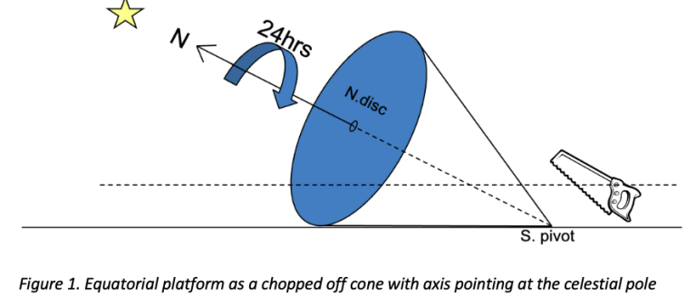

# Equatorial-Platform

## How it Works

An equatorial platform is a telescope mount used to track objects in the night sky. 

As you probably know, the night sky rotates about the celestial north pole. Lets propose a cone whose axis of symmetry is directed towards that point in the sky. If the cone rotates at the same speed as the earth, a telescope fixed to that cone should track the stars. In practice, this is implemented as a platform sitting on two cross sections of that cone. The cone is specificied in such a way that the rotational axis passes through the center of gravity of the telescope to minimize the torque needed. One of the segments is typically driven by a motor. 

## About this Design

